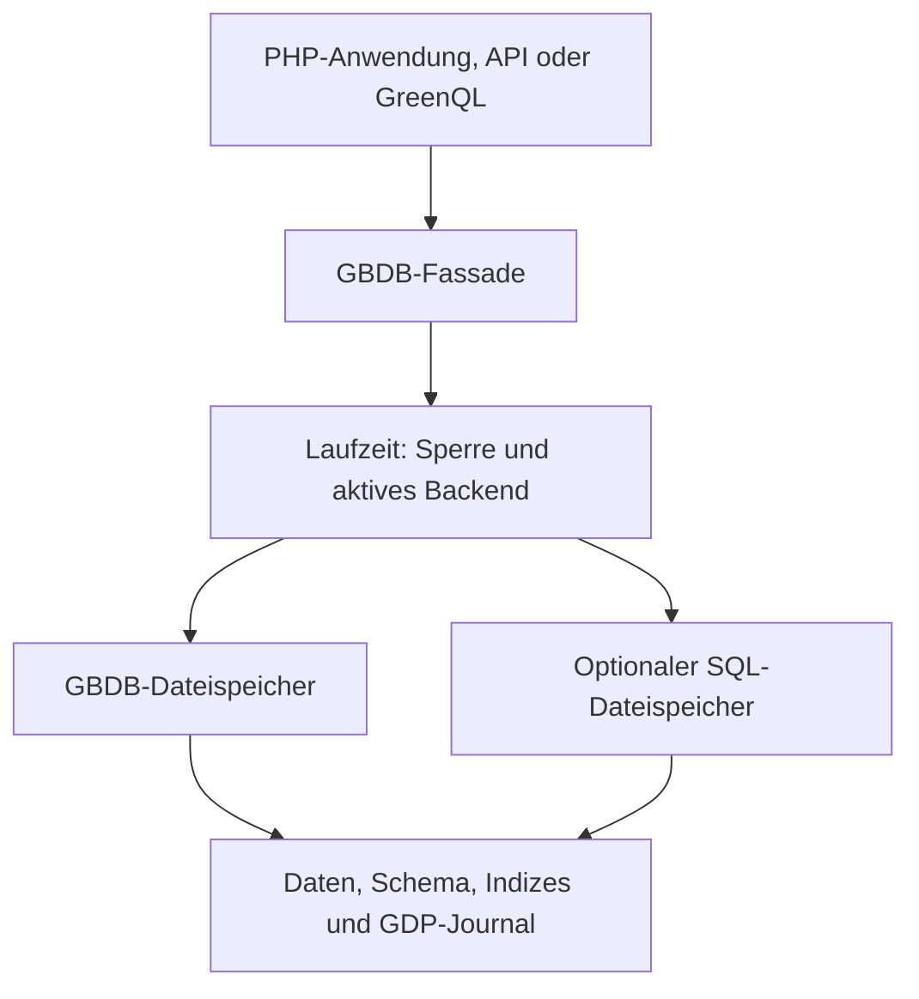

# 03 – Architektur und Ladefolge

## Verzeichnisübersicht

| Pfad | Aufgabe |
| --- | --- |
| `PHP/gbdb_framework/autoloader.php` | Zentrale Einbindung des Frameworks |
| `PHP/gbdb_framework/.config/.framework.env.php` | Vars-Konfiguration |
| `PHP/gbdb_framework/.config/.runtime/` | Lokale Geheimnisse und Laufzeitzustand |
| `PHP/gbdb_framework/runtime/` | Speichersteuerung, Dateiabstraktion und öffentliche Fassaden |
| `PHP/gbdb_framework/GBDB_GQL/db_engine/` | Interne Engine und Traits |
| `PHP/gbdb_framework/GBDB_GQL/greenql/` | GreenQL-Parser und Ausführung |
| `PHP/gbdb_framework/GBDB_GQL/.DB/` | Standard-Datenordner; durch `STORAGE.path` ersetzbar |
| `PHP/gbdb_framework/Distributed/` | GDP-Protokoll und Synchronisation |
| `PHP/gbdb_framework/core/` | Hilfsklassen und interne Auth-Engine |
| `PHP/gbdb_framework/public/` | UI-Router, Seiten, API-Dispatcher und statische Dateien |
| `PHP/gbdb_framework/SRV/` | SecondServer-Backend und Auftragsmodule |
| `PHP/gbdb_framework/plugins/` | Produktbezogene Klassen |
| `PHP/gbdb_framework/updater/` | Framework-Updater und Migrationsvorlagen |
| `PHP/gbdb_framework/version.json` | Installierte Framework-Version |
| `PHP/tests/` | GDP- und Updater-Tests |
| `docs/` | Handbuch und Methodenreferenz |
| `vsc/` | GreenQL-Erweiterung für VS Code |

## Autoloader

Die wesentliche Reihenfolge in `autoloader.php`:

1. `GBDBConfig`, Vars und das Updater-Gate laden. Das Gate prüft Wartungsmodus und ausstehende Update-Abschlüsse vor dem übrigen Framework.
2. SQL-Speicher, Laufzeit, Dateiabstraktion und Ratenbegrenzung laden.
3. Interne `GBDBEngine` und GreenQL mit ihren Traits laden.
4. PHP-Dateien aus `core/` stabil nach Dateinamen laden.
5. Öffentliche Klassen `GBDB` und `Auth` aus `runtime/` laden.
6. GDP laden und den eingebetteten Betrieb registrieren.
7. Plugins laden und das Updater-Gate nach dem Laden abschließen.

Dateien mit unterstützten Deaktivierungsmarkierungen werden vom lokalen Ordnerlader ausgelassen. Eine pauschale automatische Einbindung aller beliebigen Unterverzeichnisse findet nicht statt. `functions.php` wird nicht durch `autoloader.php` eingebunden und ist eine separate Hilfsdatei.

## Speicherweg



`Vars::data_root()` liefert den logischen Einstieg `gbdbdata://store`. `GBDBConfig::dataPath()` liefert den physischen Dateipfad. Die Engine verwendet den logischen Weg, damit SQL-Fallback und Sperren mitwirken. Direkte Dateizugriffe auf den physischen Bestand umgehen diese Laufzeit.

SQL speichert dabei GBDB-Dateiinhalte und Metadaten in Tabellen, nicht jede Anwendungstabelle als eigene relationale SQL-Tabelle. Pro Installation gibt es einen maßgeblichen Speicherstand. Eine Rückkehr von SQL zum Dateispeicher erfolgt kontrolliert nach Abgleich.

## Schnittstellenabläufe

**Public API:** Einstieg → Autoloader → POST- und Größenprüfung → Modulauflösung → Schlüsselprüfung → Aktionsrechte → Instanz-Sandbox → Modulaufruf → JSON-Antwort mit HTTP-Status.

**SecondServer:** Client fordert ein temporäres Token an → Client sendet statischen Schlüssel und Token mit einer Anweisung → SRV prüft beide → festgelegte Funktion oder Auftragsmodul → JSON-Antwort. Aufträge sind dadurch nicht automatisch asynchron.

**GDP:** Normale Engine-Schreiboperation → Policy-Prüfung und Intent → lokale Änderung → Journal → Push/Pull mit Hub. Nicht zur Replikation freigegebene Instanzen bleiben lokal.

## Instanzkontext

Instanzwahl ist pro PHP-Prozess statischer Zustand. Für zeitweilige Wechsel verwenden:

```php
$daten = GBDB::withInstance('kunde_a', static function () :array {
    return GBDB::getData('shop', 'produkte');
});
```

Bei fremdbestimmten Instanznamen zusätzlich Anwendungsrechte prüfen. Die Sandbox externer Schnittstellen blockiert interne Instanzen, ersetzt jedoch keine fachliche Mandantenberechtigung. `trustedInstance()` ist für Framework-internen Zugriff bestimmt und darf nicht zur Umgehung solcher Prüfungen verwendet werden.
